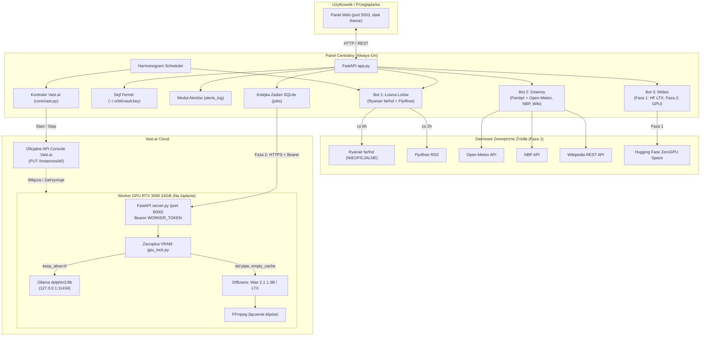

# Orbit Bots — Architektura Systemu (ARCHITECTURE.md)

Orbit Bots to modularna aplikacja zbudowana w Pythonie (FastAPI + SQLite) z interfejsem użytkownika w języku polskim, zaprojektowana w **architekturze dzielonej (split architecture)**:

1. **Panel (zawsze włączony, lekki):**
   - Działa na małym serwerze VPS lub darmowej instancji (np. Render / lokalny host).
   - Obsługuje interfejs WWW (port 5003), bota Łowca lotów (Ryanair farfnd + Fly4free RSS), pamięć rozmów bota Dziennego, narzędzia bezkluczowe (Open-Meteo, NBP, Wikipedia), kolejkę zadań, sejf Fernet oraz kontroler Vast.ai.
2. **Worker GPU (na żądanie, mocny):**
   - Działa na maszynie **Vast.ai RTX 3090 24 GB** (~0,12 $/h, lokalizacja Kanada).
   - Włączany automatycznie przez kontroler Vast tylko wtedy, gdy w kolejce pojawią się zadania GPU (Dolphin 3:8B przez Ollama lub generowanie wideo Wan 2.1 1.3B / LTX przez diffusers).
   - Automatycznie zatrzymywany po 10 minutach bezczynności (`VAST_IDLE_MIN`).

---

## Diagram Przepływu (Panel ↔ Worker GPU)

---

## Moduły Rdzenia (`core/`)

1. **`registry.py`**:
   - Definiuje abstrakcyjną klasę bazową `BotBase` z interfejsem:
     - `id`, `name`, `description`, `avatar`
     - `init(app)`: rejestracja tras routera FastAPI
     - `jobs()`: lista zadań okresowych `(nazwa, interwał_s, fn)`
     - `status()`: słownik stanu i diagnostyki
   - Rejestr `BOTS` agregujący boty do `BOT_MODULES`.

2. **`db.py`**:
   - Bezpieczna obsługa bazy danych SQLite z wątkową blokadą `threading.Lock`.
   - Automatyczna inicjalizacja tabel: `alerts_log`, `jobs_log`, `vault`, `jobs`, `fl_routes`, `fl_prices`, `fly4free_deals`, `daily_memory`, `daily_cache`.

3. **`vault.py`**:
   - Sejf danych dostępowych oparty na symetrycznym szyfrowaniu **Fernet**.
   - Klucz kryptograficzny przechowywany **poza repozytorium** (`~/.orbit/vault.key` lub w zmiennej `ORBIT_VAULT_KEY_B64` na platformach bezdyskowych) z restrykcyjnymi uprawnieniami `0600`.
   - Interfejs API zwraca do przeglądarki **jedynie nazwy kluczy**, nigdy ich zaszyfrowane ani odszyfrowane wartości.

4. **`queue.py`**:
   - Asynchroniczna kolejka zadań bazująca na SQLite (`jobs`).
   - Gwarancja sekwencyjnego wykonywania zadań GPU (jeden proces w danym momencie z lockiem `_gpu_lock`).
   - Wątek egzekutora przetwarzający zadania w tle i aktualizujący statusy (`queued` ➔ `running` ➔ `done` / `error`).

5. **`scheduler.py`**:
   - Wewnętrzny harmonogram zadań okresowych działający w dedykowanym wątku.
   - Rejestruje i wykonuje zadania botów oraz kontrolera Vast, logując każde wykonanie do tabeli `jobs_log`.

6. **`vast.py`**:
   - Kontroler maszyn wirtualnych Vast.ai komunikujący się z oficjalnym API `https://console.vast.ai/api/v0/`.
   - **Zasada bezpieczeństwa:** wywołuje wyłącznie akcje `start` (`state: running`) oraz `stop` (`state: stopped`) dla istniejącej instancji (`VAST_INSTANCE_ID`). Nigdy nie wywołuje `create` ani `destroy`.
   - Automatyczny mechanizm bezczynności wyłącza serwer po upływie `VAST_IDLE_MIN` (domyślnie 10 min) bez oczekujących zadań GPU.

---

## Moduły Botów (`bots/`)

### Bot 1: Łowca Lotów (`bots/flights/`)
- Monitoruje trasy lotnicze z 14 polskich portów lotniczych (WAW, WMI, KRK, KTW, GDN, WRO, POZ, LCJ, RZE, LUZ, SZZ, BZG, IEG, RDO, SZY).
- Źródło cen: Ryanair farfnd (nieoficjalny endpoint JSON z etykietą ostrzegawczą w UI), sprawdzany co 6 h.
- Źródło okazji: RSS portalu Fly4free.pl sprawdzany co 2 h z pełną deduplikacją po linku artykułu.
- Rejestruje historię cenową w `fl_prices` i generuje alerty przy spadku ceny poniżej zdefiniowanego progu lub o określony procent (oraz testowy alert na żądanie).

### Bot 2: Dzienny (`bots/daily/`)
- Inteligentny asystent z polskim interfejsem i pamięcią konwersacji (ostatnie 12 wiadomości w `daily_memory`) oraz możliwością wyczyszczenia pamięci przyciskiem „Zapomnij”.
- **Darmowe narzędzia Fazy 1 (bez klucza API):**
  - Pogoda przez Open-Meteo (geokodowanie + prognoza z opisem aury w j. polskim).
  - Kursy walut przez oficjalne API Narodowego Banku Polskiego (NBP Tabela A).
  - Wikipedia przez REST API streszczeń oraz OpenSearch.
  - Narzędzie webowe `fetch` (requests + BeautifulSoup) usuwające szum HTML i zapisujące wynik w izolowanym katalogu.
- **Izolacja zadań (Security Sandbox):** każde zadanie otrzymuje unikalny katalog `data/tasks/<id>/`. Metoda `validate_path()` rygorystycznie weryfikuje `realpath` i odrzuca wszelkie próby directory traversal (`../../x`).
- **Faza 2:** przekierowanie do modelu Dolphin 3:8B przez OpenAI-compatible API na workerze GPU.

### Bot 3: Wideo (`bots/video/`)
- Generator wideo z interfejsem wprowadzania promptu, wyboru modelu, formatu i liczby klipów (1–6).
- **Faza 1:** integracja z darmowym Space Hugging Face `Lightricks/ltx-video-distilled` za pomocą `gradio_client`. Wykrycie wyczerpania limitu ZeroGPU generuje czytelny komunikat dla użytkownika zamiast wyjątku.
- **Faza 2:** lokalne modele `Wan-AI/Wan2.1-T2V-1.3B-Diffusers` oraz `Lightricks/LTX-Video` uruchamiane na GPU RTX 3090.
- Sklejanie wielu klipów w płynny plik MP4 przez demuxer concat biblioteki FFmpeg.
- Gotowe pliki są trwale zapisywane w katalogu panelu `data/videos/`.

---

## Bezpieczeństwo i Izolacja

1. **Zarządzanie sekretami:**
   - Żadne tokeny API, hasła ani klucze prywatne nie są umieszczane w kodzie źródłowym ani w systemie kontroli wersji.
   - Klucz sejfu znajduje się w pliku chronionym maską bitową `0600` poza drzewem projektu.
2. **Ochrona sieciowa workera GPU:**
   - Serwer worker wymaga uwierzytelnienia tokenem Bearer (`WORKER_TOKEN`).
   - Usługa Ollama nasłuchuje **wyłącznie na pętli zwrotnej 127.0.0.1** (port 11434 nie jest wystawiony na zewnątrz).
3. **Zarządzanie zasobami VRAM (GPU Lock):**
   - Klasa `GPULock` zapobiega konfliktom między modelem językowym a generatorem wideo. Przed uruchomieniem potoku diffusers model LLM jest zwalniany z VRAM poleceniem `keep_alive=0`.
